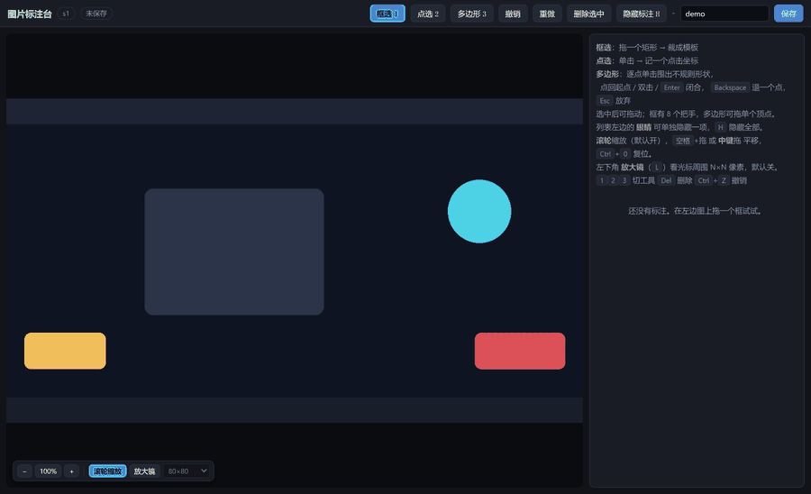

# image-annotate-mcp

[](LICENSE)
[](pyproject.toml)
[](https://modelcontextprotocol.io)
[](tests/)

**Human-in-the-loop image annotation for MCP agents.** The user draws a box on a
screenshot; the agent gets back pixel coordinates, a name, and a cropped template
image — the three things a template-matching / GUI-automation agent actually needs.

[中文说明](README.zh-CN.md)



## Why this exists

Existing image-annotation MCP servers all work the same direction: **the agent
decides the coordinates, the server draws them** (`annotation-mcp`,
`mcp-screenshot-server`, `markitup-mcp-server`). That is useless when the human is
the one who knows where the button is.

`image-annotate-mcp` flips it: **the human points, the agent receives.**

One drag gives you three things at once:

| Output | Example |
|---|---|
| exact pixel coordinates on the **original** image | `[1671, 713, 240, 70]` |
| the semantic name the human typed | `出战按钮` |
| a ready-to-use cropped template | `board_ui__img1__chuzhan.png` |

Irregular shapes work too: the polygon tool records a vertex list and masks
the template to that outline, so a diamond-shaped skill button does not drag
half the background along with it.

## Install

```bash
pip install image-annotate-mcp

# optional: live screen capture (otherwise pass a file path / base64)
pip install image-annotate-mcp[screen]

# or run it without installing
uvx --from image-annotate-mcp annotate-mcp
```

Requires Python 3.10+. Hard dependencies: `mcp`, `pillow`.

## Configure your client

```json
{
  "mcpServers": {
    "image-annotate": {
      "command": "annotate-mcp",
      "args": [],
      "timeout": 600000
    }
  }
}
```

`timeout` is in **milliseconds** and is only understood by some clients (Claude
Code, Cursor, …). It exists because of the blocking tool below — see
[Blocking, and the timeout trap](#blocking-and-the-timeout-trap).

Useful flags: `--data-dir <path>` (default `~/.image-annotate-mcp`),
`--base-port 8777`, `--no-open` (do not launch a browser, just return the URL).

## Tools

| Tool | What it does |
|---|---|
| `annotate_image` | Open a session for one or more images, return a `http://127.0.0.1:<port>/?s=<id>` URL |
| `annotate_wait` | **Block** until the user hits 保存; returns coordinates + names + template filenames |
| `annotate_status` | Non-blocking peek: `pending` / `saved` / `cancelled`, current `rev`, item count |
| `annotate_cancel` | Close a session and its web server; wakes anyone waiting |
| `annotate_list` | Annotations already on disk, newest first |
| `annotate_load` | Full structured payload of one saved annotation |
| `annotate_export` | `png` (numbered overlay) / `py` (constants) / `json` / `yaml` |
| `annotate_render` | The numbered overlay as **image content**, so a multimodal agent can read the labels itself |

### Typical flow

```text
annotate_image(source="screen", name="board_ui")
  → {"session": "s1", "url": "http://127.0.0.1:8777/?s=s1", ...}

   ... the human draws two boxes and one point, types names, clicks 保存 ...

annotate_wait(session="s1", timeout_s=240)
  → {"status": "saved", "rev": 1, "images": [{"items": [
        {"index": 1, "name": "晶矿",     "type": "point", "point": [1614, 398]},
        {"index": 2, "name": "出战按钮", "type": "box",   "box": [1671, 713, 240, 70],
         "template": "board_ui__img1__chuzhan.png"}]}]}

annotate_export(name="board_ui", fmt="py")
  → BOARD_UI_IMG1_CHUZHAN = (1671, 713, 240, 70)  # 出战按钮 · x, y, w, h
```

## The annotation page

Single self-contained HTML file: no CDN, no external fonts, no ES modules. It works
offline and is served from `127.0.0.1` only.

- **框选** (`1`) drag a rectangle → becomes a template crop
- **点选** (`2`) single click → becomes a click coordinate
- **多边形** (`3`) click each vertex of an irregular shape; close it by
  clicking the first vertex, double-clicking, or `Enter`. `Backspace` drops
  the last vertex, `Esc` abandons the outline.
- selected boxes can be **moved** and **resized** with 8 handles; polygon
  vertices can be dragged one at a time
- **hidden layers**: the eye button on a row hides that single item, `H`
  hides all of them so you can see the screenshot underneath. Hidden items
  are still saved, still get a template, and are left out of `fmt="png"`
  output.
- **wheel zoom** (on by default): zooms around the cursor, 1x-16x. Stroke widths
  and label sizes stay constant **on screen** instead of growing with the image —
  you zoom in to read pixels, not to inflate the annotation boxes.
  Hold `Space` and drag, or drag with the **middle button**, to pan; `Ctrl+0`
  resets. The small bar in the bottom-left can turn wheel zoom off and reset the view
- **loupe** (off by default, `L` toggles): a draggable floating window showing an
  N x N **image pixel** region around the cursor, magnified (N = 40 / 60 / 80 / 120),
  with the exact pixel under the cursor outlined. Drag it elsewhere to pin it,
  click the button in its title bar to resume following. It magnifies original
  pixels, independent of the current zoom level
- real **undo / redo** (`Ctrl+Z` / `Ctrl+Shift+Z`), `Delete` removes the selection
- multiple images in one session → tab strip at the top
- coordinates are always in **original image pixels**, and the canvas honours
  `devicePixelRatio` so HiDPI screens do not shift them by half a pixel. Zoom and
  pan only change the view, never that mapping: clicking a pixel at 8x saves the
  same coordinate as clicking it at 1x (`tests/manual/e2e_view.py` guards this)

## Data model

```json
{
  "schema": 2,
  "name": "board_ui",
  "created_at": "2026-11-15 16:32:04",
  "saved_at": "2026-11-15 16:40:11",
  "rev": 3,
  "images": [
    {
      "id": "img1",
      "name": "主界面",
      "source": "file:/path/a.png",
      "size": [1920, 1080],
      "snapshot": "board_ui__img1.png",
      "items": [
        {"index": 1, "name": "晶矿", "type": "point", "point": [1614, 398], "note": ""},
        {"index": 2, "name": "出战按钮", "type": "box", "box": [1671, 713, 240, 70],
         "note": "", "template": "board_ui__img1__chuzhan.png"},
        {"index": 3, "name": "技能环", "type": "polygon",
         "points": [[820, 300], [1010, 340], [960, 520], [790, 470]],
         "bbox": [790, 300, 220, 220], "hidden": true,
         "note": "", "template": "board_ui__img1__jineng.png"}
      ]
    }
  ]
}
```

`bbox` is the polygon's vertex bounding rectangle in the same `[x, y, w, h]`
shape as a box, so a consumer that only understands boxes still has something
to work with. `hidden` is present only when the item is hidden.

Files written to `--data-dir` (default `~/.image-annotate-mcp`):

```
annotations/<slug>.json     structured, source of truth
annotations/<slug>.md       markdown table, quicker for an agent to skim
templates/<slug>____<item>.png    one crop per item (polygons masked, RGBA)
sources/<slug>__.png   copy of the base image, so exports survive deletion
exports/                    annotated overlays and generated constants
```

Template filenames are **ASCII-only** (`item1`, `chuzhan`, …) because they end up
inside generated code; the original name — Chinese included — is kept in the JSON,
the Markdown and the generated comments.

## Blocking, and the timeout trap

`annotate_wait` is a **human-in-the-loop** tool: it deliberately blocks while a
person draws. Two consequences:

1. **A blocking call is not a hang.** The page shows 未保存 / 已保存 so the human can
   see the state; the agent sees nothing until the save lands.
2. **MCP clients have their own tool timeout**, often 60 s. If the client kills the
   call first you get something like `MCP error -32001: Request timed out`.

So the server default is `timeout_s=240` and a timeout is **not an error**:

```json
{"status": "pending", "rev": 0, "elapsed_s": 240.0,
 "hint": "用户还没点保存（已等 240.0s）。可以再调一次 annotate_wait 继续等…"}
```

The rule is: **server timeout < client timeout**, and on `pending` just call
`annotate_wait` again (with `since_rev` set to the `rev` you already have). If your
client supports a `timeout` field, raise it well above 240 s.

## Screen capture

`source="screen"` (or omitting `source`) grabs the primary monitor; `"screen:0"`
grabs the whole virtual desktop, `"screen:2"` a specific monitor.

- `mss` is used when installed (`pip install image-annotate-mcp[screen]`) — best
  multi-monitor behaviour.
- Otherwise `PIL.ImageGrab` is tried, which works on Windows and macOS but usually
  fails on Linux (no display server helper). The error tells you what to install.
- Without any backend, `annotate_image` still accepts file paths, data URLs, raw
  base64 and `http(s)` URLs.

The image is **not** resampled by default, so coordinates match the original file
exactly. `resize_to=[w, h]` is opt-in and the result reports both sizes.

## Troubleshooting

| Symptom | Cause / fix |
|---|---|
| Page loads but `annotate_wait` returns `pending` forever | You are looking at a stale tab. Use the exact URL from `annotate_image`. |
| `403` in the browser | The port belongs to a different session id. Re-open the URL you were given. |
| `端口 8777–8796 全被占用` | Pass `--base-port 9000` (or any free range). |
| `curl`/`requests` to `127.0.0.1` returns a proxy error | A local proxy (Clash etc.) is intercepting loopback. Use `--noproxy '*'` / set `NO_PROXY=127.0.0.1`. |
| `MCP error -32001: Request timed out` | Client timeout fired. Raise the client `timeout` and/or lower `timeout_s`. |
| Template files look stale | Re-saving the same name overwrites the JSON/MD and the templates of items that still exist; templates of deleted items are left on disk on purpose. |
| A box is clamped to the image edge | Expected: boxes are clipped to the image, and the `/save` response reports how many were clamped. |
| Saving fails with `面积是 0` | The polygon's vertices are all collinear, so its crop would be fully transparent. Re-click the outline, or use 框选 instead. |

## Use it as an Agent Skill

The server tells the agent *what* the tools do; `skills/image-annotate/SKILL.md` tells it
*when* to reach for them and how to drive the loop without wasting round trips. Drop the
folder where your client looks for skills (for Claude Code that is
`~/.claude/skills/image-annotate/`), or paste the file into your agent's system prompt.

It is worth reading even if you never install it — the "Do not" section is the list of
mistakes an agent makes with this server when nobody tells it otherwise.

## Development

```bash
python -m venv .venv
.venv/Scripts/activate            # Windows;  source .venv/bin/activate elsewhere
pip install -e ".[dev]"

pytest                            # 73 tests
ruff check . && ruff format --check .
```

What the tests cover: coordinate clamping and crop correctness (the crop must be the
exact pixels under the box), EXIF rotation, the blocking handshake and its timeout
path, `since_rev`, cancel-wakes-waiter, port roll-over, atomic save (an agent must
never see items without `template`), file layout, v1 compatibility, all four export
formats, every HTTP endpoint, polygon vertex clamping + masked crops + the
refusal of zero-area outlines, the `hidden` flag, and a real JSON-RPC round trip
over stdio.

Two manual checks need a browser and are not part of pytest:

```bash
python tests/manual/e2e.py --two          # prints a URL, waits for the save
node   tests/manual/verify_page.mjs <url> # drives Edge, compares aimed vs saved coordinates
python tests/manual/e2e_polygon.py        # polygon + hidden layers, 22 checks, self-contained
node   tests/manual/make_gif.mjs <url> && python tests/manual/make_gif.py
```

## License

MIT. See [LICENSE](LICENSE).
