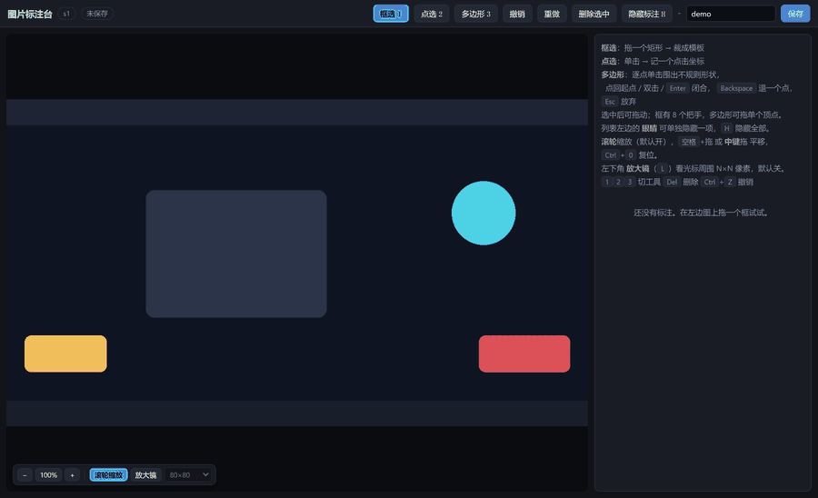

# image-annotate-mcp

[](LICENSE)
[](pyproject.toml)
[](https://modelcontextprotocol.io)
[](tests/)

**给 MCP agent 用的「人在回路」图片标注器。** 用户在截图上框一下，agent 拿到的是
**原图像素坐标 + 语义名 + 裁剪好的模板图** —— 模板匹配 / 界面自动化真正需要的那三样。

[English](README.md)



## 为什么做这个

现有的图片标注类 MCP 全是同一个方向：**agent 给坐标，服务端照着画**
（`annotation-mcp`、`mcp-screenshot-server`、`markitup-mcp-server` 都是）。
可当「按钮在哪」只有人知道的时候，这条路走不通 —— 让 agent 自己看图猜，猜错了也没法快速纠正。

这个项目把方向翻过来：**人指，agent 收。**

一次框选同时给你三样东西：

| 产出 | 例子 |
|---|---|
| **原图**上的精确像素坐标 | `[1671, 713, 240, 70]` |
| 人打上去的语义名 | `出战按钮` |
| 可直接用的裁剪模板 | `board_ui__img1__chuzhan.png` |

不规则形状也能标：多边形工具记的是顶点列表，模板按轮廓把外面挖空，
所以菱形技能按钮不会连带拖走半屏背景。

## 安装

```bash
pip install image-annotate-mcp

# 可选：实时抓屏（不装的话就传文件路径 / base64）
pip install image-annotate-mcp[screen]

# 或者不安装直接跑
uvx --from image-annotate-mcp annotate-mcp
```

要求 Python 3.10+。硬依赖只有 `mcp` 和 `pillow`。

## 配置客户端

```json
{
  "mcpServers": {
    "image-annotate": {
      "command": "annotate-mcp",
      "args": [],
      "timeout": 600000
    }
  }
}
```

`timeout` 单位是**毫秒**，而且只有部分客户端认这个字段（Claude Code、Cursor 等）。
它存在的原因见下面[「阻塞与超时陷阱」](#阻塞与超时陷阱)。

常用参数：`--data-dir <路径>`（默认 `~/.image-annotate-mcp`）、`--base-port 8777`、
`--no-open`（不自动开浏览器，只把 URL 返回给你）。

## 工具一览

| 工具 | 作用 |
|---|---|
| `annotate_image` | 开一个标注会话（支持多张图），返回 `http://127.0.0.1:<端口>/?s=<id>` |
| `annotate_wait` | **阻塞**到用户点「保存」，返回坐标 + 名称 + 模板文件名 |
| `annotate_status` | 非阻塞查状态：`pending` / `saved` / `cancelled`、当前 `rev`、已标几项 |
| `annotate_cancel` | 关会话和它的网页服务，同时唤醒所有在等的人 |
| `annotate_list` | 磁盘上已有的标注，新的在前 |
| `annotate_load` | 读回某一份标注的完整结构化数据 |
| `annotate_export` | `png`（带编号的标注图）/ `py`（坐标常量）/ `json` / `yaml` |
| `annotate_render` | 把带编号的标注图作为**图片内容**返回，多模态 agent 可以自己认名字 |

### 典型流程

```text
annotate_image(source="screen", name="board_ui")
  → {"session": "s1", "url": "http://127.0.0.1:8777/?s=s1", ...}

   …… 用户在页面上框两个框、点一个点、改名、点「保存」……

annotate_wait(session="s1", timeout_s=240)
  → {"status": "saved", "rev": 1, "images": [{"items": [
        {"index": 1, "name": "晶矿",     "type": "point", "point": [1614, 398]},
        {"index": 2, "name": "出战按钮", "type": "box",   "box": [1671, 713, 240, 70],
         "template": "board_ui__img1__chuzhan.png"}]}]}

annotate_export(name="board_ui", fmt="py")
  → BOARD_UI_IMG1_CHUZHAN = (1671, 713, 240, 70)  # 出战按钮 · x, y, w, h
```

## 标注页面

单文件自包含 HTML：不依赖 CDN、不外链字体、不用 ES module，断网也能开；
只监听 `127.0.0.1`。

- **框选**（`1`）拖一个矩形 → 裁成模板文件
- **点选**（`2`）单击 → 记一个点击坐标
- **多边形**（`3`）逐点单击围出不规则形状，点回起点 / 双击 / `Enter` 闭合；
  `Backspace` 退一个点，`Esc` 放弃
- 选中的框可以**拖动**，8 个把手可以**改大小**；多边形可以拖单个顶点
- **隐藏图层**：列表每行的眼睛按钮只隐藏那一项，`H` 一次隐藏全部
  （为了看清底图）。隐藏的项照样保存、照样有模板，只是不出现在页面和
  `fmt="png"` 的标注图里
- **滚轮缩放**（默认开）：以光标为中心放大到 1×–16×。放大后线宽和字号保持**屏幕**
  大小，不跟着图一起变大 —— 放大是为了看清像素，不是把标注框也吹大。
  `空格`+拖 或 **中键拖** 平移，`Ctrl+0` 复位；左下角的小工具条能关掉滚轮缩放、
  点百分比复位
- **放大镜**（默认关，`L` 开）：一个可拖动的浮窗，显示光标周围 N×N **图像像素**的
  放大图（N 可选 40 / 60 / 80 / 120），光标所在的那一个像素被单独框出来。
  窗口能拖到别处固定住，点标题栏按钮切回自动跟随。它按原图像素放大，
  跟当前缩放级别无关
- 真正的**撤销 / 重做**（`Ctrl+Z` / `Ctrl+Shift+Z`），`Delete` 删选中项
- 一个会话可以放多张图 → 顶部出现切换标签
- 坐标永远是**原图像素**；canvas 处理了 `devicePixelRatio`，高分屏不会偏半个像素。
  缩放和平移只改视图，不改这套换算 —— 放大到 8× 再点，落盘坐标和 1× 时点同一个
  像素的结果完全一样（`tests/manual/e2e_view.py` 盯着这条）

## 数据格式

```json
{
  "schema": 2,
  "name": "board_ui",
  "created_at": "2026-11-15 16:32:04",
  "saved_at": "2026-11-15 16:40:11",
  "rev": 3,
  "images": [
    {
      "id": "img1",
      "name": "主界面",
      "source": "file:/path/a.png",
      "size": [1920, 1080],
      "snapshot": "board_ui__img1.png",
      "items": [
        {"index": 1, "name": "晶矿", "type": "point", "point": [1614, 398], "note": ""},
        {"index": 2, "name": "出战按钮", "type": "box", "box": [1671, 713, 240, 70],
         "note": "", "template": "board_ui__img1__chuzhan.png"},
        {"index": 3, "name": "技能环", "type": "polygon",
         "points": [[820, 300], [1010, 340], [960, 520], [790, 470]],
         "bbox": [790, 300, 220, 220], "hidden": true,
         "note": "", "template": "board_ui__img1__jineng.png"}
      ]
    }
  ]
}
```

`bbox` 是多边形顶点的外接矩形，形状和框选的 `[x, y, w, h]` 一样，
这样只认框的消费方也还能用。`hidden` 只在被隐藏时才出现。

落盘到 `--data-dir`（默认 `~/.image-annotate-mcp`）：

```
annotations/<slug>.json     结构化数据，唯一真相来源
annotations/<slug>.md       Markdown 表格，agent 扫起来更快
templates/<slug>____<item>.png    每项裁一张（多边形按轮廓挖空，RGBA）
sources/<slug>__.png   底图副本，原图删了也能重新导出
exports/                    标注图与生成的常量
```

模板文件名**只用 ASCII**（`item1`、`chuzhan`……），因为它们会被写进生成的代码里；
中文原名保留在 JSON、Markdown 和生成的注释里。

## 阻塞与超时陷阱

`annotate_wait` 是**人在回路**工具，它会在有人画图的时候一直阻塞。两个后果：

1. **阻塞不等于卡死。** 页面上会显示「未保存 / 已保存」，人能看见状态；
   agent 在保存落盘之前什么都拿不到。
2. **MCP 客户端自己也有一层工具超时**，常见是 60 秒。客户端先超时的话，
   你会看到 `MCP error -32001: Request timed out` 这类报错。

所以服务端默认 `timeout_s=240`，而且超时**不是错误**：

```json
{"status": "pending", "rev": 0, "elapsed_s": 240.0,
 "hint": "用户还没点保存（已等 240.0s）。可以再调一次 annotate_wait 继续等…"}
```

规则是：**服务端超时 < 客户端超时**；拿到 `pending` 就带着 `since_rev` 再调一次
`annotate_wait` 接着等。客户端如果支持 `timeout` 字段，把它设到 240 秒以上。

## 抓屏

`source="screen"`（或干脆不传）抓主屏；`"screen:0"` 抓整个虚拟桌面，
`"screen:2"` 抓指定显示器。

- 装了 `mss` 就用它（`pip install image-annotate-mcp[screen]`），多显示器最稳。
- 没装则退回 `PIL.ImageGrab`：Windows / macOS 可用，Linux 通常失败
  （缺 display server 辅助程序）。失败时错误信息会告诉你装什么。
- 完全没有抓屏后端时，`annotate_image` 依然接受本地路径、data URL、裸 base64 和
  `http(s)` 链接。

图片**默认不重采样**，所以坐标和原文件严格对应。`resize_to=[宽, 高]` 是显式可选的，
而且结果里会同时报 `size_before` / `size_after`。

## 排错

| 现象 | 原因 / 怎么办 |
|---|---|
| 页面能开，但 `annotate_wait` 一直 `pending` | 你可能开着旧的标签页。用 `annotate_image` 返回的那个 URL。 |
| 浏览器里 403 | 这个端口属于别的会话 id。用给你的 URL 重开。 |
| `端口 8777–8796 全被占用` | 加 `--base-port 9000`（或任何空闲段）。 |
| `curl` / `requests` 访问 `127.0.0.1` 报代理错 | 本机代理（Clash 之类）劫持了回环。用 `--noproxy '*'`，或设 `NO_PROXY=127.0.0.1`。 |
| `MCP error -32001: Request timed out` | 客户端超时了。调大客户端 `timeout`，或调小 `timeout_s`。 |
| 模板文件看着是旧的 | 同名重存会覆盖 JSON/MD 和**仍然存在**的那些项的模板；已删除项的模板故意留在磁盘上，不替你删数据。 |
| 框被贴到图片边缘 | 正常：框会被裁进图片范围，`/save` 的响应里会报有几项被裁剪过。 |
| 保存多边形报 `面积是 0` | 顶点都在同一条线上，裁出来会是一张全透明的空图。重点几个点，或者改用框选。 |

## 当作 Agent Skill 用

服务端只告诉 agent 工具**能做什么**；`skills/image-annotate/SKILL.md` 告诉它**什么时候该用**、
以及怎么把这个来回走完而不浪费轮次。把这个目录放到客户端的 skills 目录（Claude Code 是
`~/.claude/skills/image-annotate/`），或者直接把文件内容贴进 agent 的系统提示词。

就算不装也值得读一遍 —— 里面「Do not」那一节列的，正是没人提醒时 agent 会犯的错。

## 开发

```bash
python -m venv .venv
.venv/Scripts/activate            # Windows；其他平台用 source .venv/bin/activate
pip install -e ".[dev]"

pytest                            # 73 个用例
ruff check . && ruff format --check .
```

测试覆盖：坐标裁剪与模板像素正确性（裁出来的必须是框下那几个像素）、EXIF 旋转、
阻塞握手与超时分支、`since_rev`、取消唤醒等待方、端口顺延、原子保存
（agent 绝不能拿到没有 `template` 的项）、文件布局、v1 兼容、四种导出格式、
每个 HTTP 端点、多边形顶点夹取 / 掩膜裁剪 / 零面积拒绝、`hidden` 标记，
以及一次真正的 stdio JSON-RPC 往返。

有两个需要浏览器的验证脚本，不在 pytest 里：

```bash
python tests/manual/e2e.py --two          # 打印 URL，等保存
node   tests/manual/verify_page.mjs <url> # 驱动 Edge，比对「瞄准的坐标」与「落盘的坐标」
python tests/manual/e2e_polygon.py        # 多边形 + 隐藏图层，自包含 22 项检查
node   tests/manual/make_gif.mjs <url> && python tests/manual/make_gif.py
```

## 许可证

MIT，见 [LICENSE](LICENSE)。
